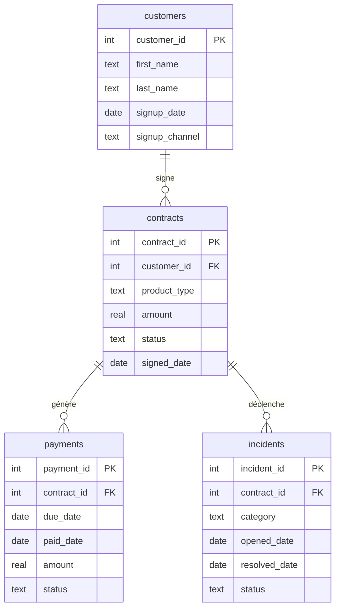

# SQL — Core Banking Analytics

> **Projet personnel — données fictives.** Clients, contrats, versements et incidents sont 100 % synthétiques, générés pour l'apprentissage et la démonstration.
> **© 2026 Hamza Dziri — Tous droits réservés.** Projet personnel publié à titre de démonstration ; toute reproduction ou réutilisation, totale ou partielle, sans autorisation écrite préalable de l'auteur est interdite.

## Objectif

Illustrer une démarche d'analyse SQL sur un modèle de données bancaire simple : partir d'un schéma propre, poser des **questions métier** en langage naturel, puis y répondre avec des requêtes progressives et commentées.

Ce dépôt reflète un apprentissage en cours : les requêtes couvrent les fondamentaux solides (sélection, filtres, agrégats, regroupements, jointures) plutôt que des techniques avancées.

## Modèle de données



## Contenu

| Fichier | Contenu |
|---|---|
| `schema/schema.sql` | Création des 4 tables (DDL commenté) |
| `data/seed.sql` | Jeu de données synthétique : 12 clients, 15 contrats, 30 versements, 8 incidents |
| `queries/01…07` | Requêtes numérotées, de la plus simple à la plus complète |

## Les requêtes

| # | Technique | Question métier |
|---|---|---|
| 01 | `SELECT`, `WHERE`, `ORDER BY` | Quels contrats actifs ont été signés en 2026 ? |
| 02 | `COUNT`, `GROUP BY` | Comment le portefeuille se répartit-il par statut ? |
| 03 | `SUM`, `AVG`, `GROUP BY` | Quels montants par type de produit ? |
| 04 | `COUNT`, `GROUP BY` | Par quel canal les clients arrivent-ils ? |
| 05 | `JOIN` | Qui est le client derrière chaque contrat actif ? |
| 06 | `GROUP BY`, `HAVING`, filtre d'agrégat | Quels contrats cumulent des versements en retard ? |
| 07 | `COUNT`, `AVG`, dates | Quelles catégories d'incidents reviennent le plus, et en combien de temps sont-elles résolues ? |

## Exécution (SQLite)

```bash
sqlite3 novabank.db < schema/schema.sql
sqlite3 novabank.db < data/seed.sql
sqlite3 novabank.db < queries/03_amounts_by_product.sql
```

## Démarche

1. **Lire le schéma avant d'écrire la moindre requête** : savoir quelles tables existent, ce qu'elles contiennent et comment elles se relient.
2. **Formuler la question métier d'abord** : chaque fichier de requête commence par la question à laquelle il répond.
3. **Construire par étapes** : filtrer, puis regrouper, puis agréger — et vérifier le résultat à chaque étape sur le jeu de données, dont les valeurs sont connues.

## Suite envisagée

- Sous-requêtes et fonctions de fenêtrage (`ROW_NUMBER`, `SUM() OVER`)
- Taux de conversion mensuel des signatures (cohortes par mois de signature)
- Vue réutilisable « santé du portefeuille »

---

*Projet personnel d'apprentissage — toutes les données sont fictives.*
